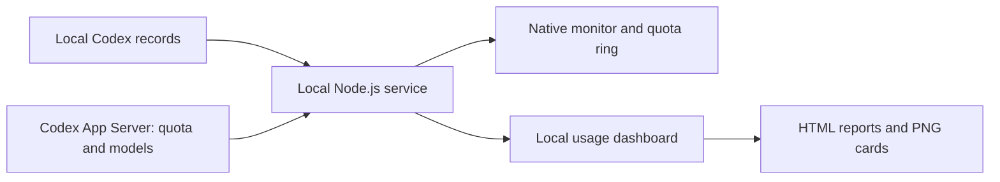

# Codex Sidekick｜Codex 搭子 · Design
### Make Codex usage easier to see.

[Overview](README.md) · [中文设计说明](DESIGN.zh-CN.md)

## The problem

Quota checks interrupt the current task. Usage is scattered across chats, and model choices lack a quick explanation. Sidekick brings these signals closer to the work and turns readable local history into a usage dashboard.

## The approach

| Surface | Role |
| --- | --- |
| Chat monitor | Tokens, current model, latest completed-call speed, status and model suggestions |
| Quota ring | Remaining quota and reset time; click to toggle analysis, right-click for themes and reports |
| Local dashboard | Time ranges, trends, model distribution, HTML reports and share cards |
| Windows tray watcher | Independent monitoring and startup recovery with user-controlled pause and disable options |

The analysis panel hides without closing its page, so v0.4.8 restores the same tab and date range. Projects and chats can have individual colors; 20 themes carry through the monitor, dashboard and exports.

## Data flow

Native integration uses a loopback Electron debugging connection and does not rewrite Codex installation files. Monitoring reads local state and logs. Suggestions use local rules and available model options; they do not trigger generation or change the user's model. PNG cards are rendered locally with Canvas.

## Keep the numbers honest

- The ring shows a quota-window percentage, not an exact remaining token balance.
- Cached input is already included in input; reasoning is included in output.
- Response speed is the latest completed call's average, including reasoning output, not a live streaming rate.
- Historical reports use readable timestamped local usage records. Missing history is not estimated; device/account attribution may be incomplete.
- Unknown or stale data is shown as unknown or waiting rather than invented.

## Privacy and compatibility

Configuration, local indexes and reports stay in the install folder and are excluded from releases. The tool does not upload them to an author-operated server. Full HTML reports contain chat details; share images omit names/account details unless the user adds an optional public profile.

Local debugging is accessible to programs on the same machine. Disable auto-loading and monitoring, normally exit Codex and use the official launcher to restore default startup.

**Windows has been tested; macOS compatibility is unverified.** The v0.4.8 panel interaction has desktop verification. Full Windows reboot and automatic exit/reopen recovery still need real-device validation. Codex updates can affect integration, so automated checks do not guarantee every client version.

Part of the App Server/CDP integration is adapted from Codex Usage Badge under MIT; see [third-party credits](THIRD-PARTY-NOTICES.md). Share images carry **Design by KandyTiao**.
