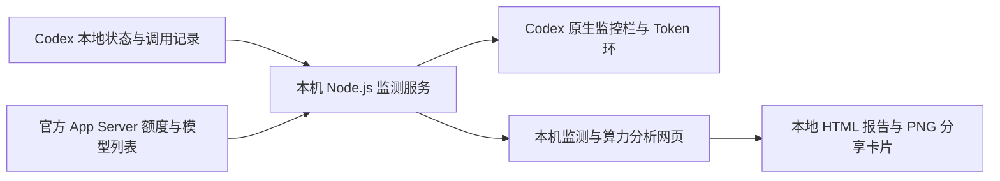

# Codex Sidekick｜Codex 搭子 · 设计说明

> **平台验证范围：目前仅完成 Windows 版本实测。macOS 安装脚本已提供，但未在 Mac 上运行验收，兼容性尚未确认。**
>
> 社区制作的 Codex 辅助工具，与 OpenAI 无官方隶属关系。

## 为什么设计这个工具

使用 Codex 时，用户常常需要离开当前任务才能查看额度，也难以在一个位置比较模型、Token 用量与响应速度。Codex Sidekick 将这些信息放到聊天附近，并提供按时间整理的本机使用账单，让用户更容易判断当前任务的运行状态、选择适合的模型，以及回顾自己的使用习惯。

## 三个主要入口

| 入口 | 展示内容 | 设计目的 |
| --- | --- | --- |
| 聊天监控栏 | 模型建议、当前模型、累计 Token、最近完整调用的响应均速、执行状态 | 在当前任务旁边读取状态；悬停查看口径和推荐理由 |
| Token 环 | 官方接口返回的周额度剩余比例、重置倒计时；可用时显示 5 小时窗口 | 左键切换原生分析面板；右键进入主题、分析和导出 |
| 算力分析页面 | 时间范围、调用明细、模型分布、使用趋势、报告和分享卡片 | 将分散的本机调用记录整理为可回顾的账单 |

“Token 环”是界面名称，圆环实际表示套餐使用窗口的剩余百分比，不表示可兑换的精确 Token 数。

## 交互与视觉

监控栏采用两行信息，共享左侧文字基准，以细线区分推荐与运行数据。默认固定在标题栏下方并锁定；用户先解锁才能拖动，支持调宽、收起、隐藏及恢复。

20 种主题覆盖明暗跟随、固定色与渐变色。Token 环、监控栏、分析页面及导出图片使用同一主题；项目与聊天也能独立标色，帮助区分并行任务。

v0.4.8 的 Token 环左键在原生界面打开或隐藏算力分析面板。隐藏只收起面板，不关闭页面；再次点击恢复已有分析标签，保留范围与页面状态，避免重复创建标签。分析处于后台或其他文档正在显示时先切到分析；用户用原生按钮隐藏后也能从 Token 环恢复，当前聊天不切换。控制使用原生面板的数据属性识别状态。本地网页继续通过链接打开分析。

导出遵循“选择范围 → 确认日期和调用数量 → 预览 → 保存”的顺序，减少误导出时间范围。支持朋友圈、Instagram、小红书、抖音和方图尺寸，也能生成 9 张不同内容的卡片、3×3 拼图及 ZIP。图片右下角保留小字 **Design by KandyTiao**。

## 工作方式

- **本地记录读取**：解析状态库与带时间的调用用量记录；后台增量建立账单索引。
- **聊天身份识别**：读取 Codex 保存的客户端编号与正式编号映射，侧栏、监控栏和标签继承共用解析；没有记录时显示等待，当前旧聊天按编号补读，避免借用其他聊天的用量。
- **额度读取**：通过 Codex 自带 App Server 查询额度和可选模型，不要求用户另填 API key。
- **界面接入**：通过本机 Electron 调试接口显示组件，不改写官方安装文件。
- **模型建议**：使用中文／英文关键词及累计任务约束的本地规则；只给出建议，不自动切换模型、思考强度或高速模式。
- **分享生成**：使用本机浏览器 Canvas 绘制 PNG；生成图片与规则分析不额外发起模型生成调用。

核心实现使用 Node.js 24+ 和浏览器原生能力，无需下载 npm 第三方运行依赖。部分 App Server、CDP 与侧栏功能改编自 Codex Usage Badge，来源与 MIT 许可见 [第三方说明](THIRD-PARTY-NOTICES.md)。

## Windows 自动加载

v0.4.7 延续当前用户的托盘守护。安装默认在 Windows 启动文件夹登记一个快捷方式，指向软件盘内的脚本；该目录拒绝写入时，自动回退 `HKCU\Software\Microsoft\Windows\CurrentVersion\Run` 的 `CodexSidekick` 值，仍只作用于当前用户。升级沿用已保存的注册表方式。`config.json` 的 `autoStartMethod` 记录 `startup` 或 `registry`，只读状态查询返回方式及注册状态。Windows 登录后约 8 秒启动守护；守护复用健康监测，发现 Codex 未运行时以增强参数打开，每次重新定位已注册的官方安装路径。

v0.4.4 从 Codex 内通过普通 `Start-Process` 开启守护时，子进程可能继承 Codex 工具进程的 Windows Job。现场诊断发现该 Job 设置了关闭时终止成员的限制；用户仅退出 Codex 后，守护和监测都消失，而 Windows 启动项仍在。登录启动项不会在应用退出时重新执行，因此不能恢复这一情形。

v0.4.5 改为调用现有 Explorer 桌面的启动代理：通过 `ShellWindows.FindWindowSW` 找到桌面，再由其 `Document.Application.ShellExecute` 隐藏启动守护，避免继承 Codex 工具进程的退出限制。守护再开启监测。入口最多等待 10 秒，确认守护已创建 StopEvent 才返回，以便随后的停止或升级能向守护发出退出请求；桌面代理不可用或初始化超时会明确报错，不回退到普通子进程。守护日志记录 PID、父 PID、是否处于 Job 以及可读的 Job 限制标记，帮助定位异常退出。

独立守护解决了后台随 Codex 消失的问题，但 v0.4.5 的 5 秒轮询与退出后 8 秒宽限仍可能错过接管：守护等待时，普通 Codex 已先从其他入口打开。v0.4.6 为已识别的 Codex 主进程保留 .NET `Process` 句柄，每 500 毫秒用 `HasExited` 检查真实退出，避免每次执行完整进程发现。常规维护仍每 5 秒进行，登录启动的 8 秒延迟继续保留。

捕捉真实退出后立即进行完整检查，确认没有其他 Codex 主进程，才以增强参数启动；常规维护扫描确认主进程全无时同样启动，完全取消人工设置的 8 秒重启宽限。等任务结束后正常完全退出，应交给搭子自动打开，实际打开耗时取决于系统；手动启动可使用桌面 **Codex 搭子** 入口。若其他普通窗口抢先启动，守护只提示等待任务完成后正常完全退出；无法为既有进程补加启动参数，也不强制关闭任务。安装目录独立的互斥锁避免重复守护与并发启动，退出检查不会绕过暂停或停止请求。

v0.4.7 补齐更新时的启动恢复：Store 包注册或版本目录变化时，每次启动最多重新发现 3 次，间隔 500 毫秒。健康检查后再次扫描主 GUI，保护期间从其他入口启动的普通窗口。首次发现没有包也进入有限重试；仍未找到时，守护显示未找到程序并在 30 秒后重试。

“已接入”同时要求 CDP 可达、监测版本匹配及 `health.native.connected > 0`，不把成功创建进程或调试端口可达当作完整接入。请求启动后限 20 轮等待，每轮间隔 500 毫秒；未接入会说明调试端口与已登记连接状态。需等用户退出的状态返回码为 2，由守护／托盘解释为等待；真正失败返回 1，不误报为启动成功。

桌面入口发现已有普通窗口时，先释放启动互斥锁再显示修复确认；用户选择“是”后重新加锁、重新发现并核查窗口，再通过 `CloseMainWindow` 请求正常关闭。最多等待 10 秒，窗口未退出时提示用户从菜单正常退出，不调用 Kill。选择“否”保留当前窗口、稍后处理。自动守护使用无弹窗路径，只等待正常退出；它不主动关闭任务。所有结果提示也在释放启动锁后展示。

用户可以从托盘打开 Codex 或算力分析、暂停本次自动恢复、关闭登录自启动，或退出搭子本次。退出搭子会停止守护和监测，下次登录仍按原设置启动；关闭登录自启动会撤销启动项，升级保留这一选择。安装的 `-NoAutoStart` 关闭默认行为，`-NoStart` 仅控制当下是否启动进程。关闭监测先停守护；关闭自动加载与卸载均清理本安装在启动文件夹和注册表中的自身项目。

此流程复用官方已有登录状态，不保存密码或绕过认证；首次登录、会话过期或官方重新认证时仍需用户操作。系统位置只登记小快捷方式或注册项；程序、日志、配置与账单仍在软件盘，不因系统启动项位于 C 盘而迁移。不改写官方程序或官方快捷方式，不需要管理员权限。

## 统计口径

- 累计 Token 来自本机记录，通常是多次请求的输入与输出总量；不是当前上下文长度、费用或精确套餐扣减。
- 缓存 Token 已包含在输入，思考 Token 已包含在输出；合计只计算输入 + 输出。
- 响应均速使用最近完成调用的输出 Token 除以响应阶段耗时，包含思考输出；不是逐秒流式速度。缺少可靠计时记录时显示未知。
- 账单只统计能够读取且带时间的调用记录。只有累计数值的旧记录不倒推日期，不估算缺失明细。
- 统计基于本机 Codex 数据目录，无法确认跨设备使用情况或历史账号归属，因此不宣称是全账号完整账单。

## 数据与隐私

监测网页只绑定本机 `127.0.0.1`。程序不将聊天正文、用量索引或报告上传到作者服务器。任务分类会在内存中读取近期用户要求；本工具不保存或上传这些要求的原文。

配置、颜色、布局、账单索引和报告保存在用户选定的安装目录。开发源码保留在私有仓库；公开介绍与使用包排除本机配置、日志、会话、报告及登录资料。

分享图片默认不包含聊天名称、邮箱或账号 ID。头像与公开昵称由用户选择是否加入；完整 HTML 账单包含聊天明细，建议用于本人留存。

增强启动会开启本机调试接口；同机程序可能访问该接口。需要恢复默认启动状态时，先关闭自动加载和监测，正常完全退出 Codex，再用官方入口重新打开。

## 兼容性与已知边界

**目前仅完成 Windows 实测，不能确认 Mac 系统兼容性。** 此前在官方 `26.1002.7124.0` 的独立未登录窗口验证过 CDP 与组件脚本。v0.4.8 已在当前原生窗口验证分析面板的打开、隐藏、同标签恢复、月范围保留、原生按钮隐藏后恢复、其他文档切回分析及当前聊天不变，未重开官方 GUI。本轮仅覆盖这项交互，没有重新验收自动重开或 Windows 整机重启。macOS 原流程保留，仍未实机验收；持续集成不能替代 Mac 实机验证。

Codex 原生界面接入依赖 Electron 调试接口、界面结构和日志格式。自动加载解决启动恢复，不能保证未来所有客户端版本的界面兼容。官方更新可能影响组件位置、速度解析或连接；无法获取的数据应显示未知或等待。本机网页是独立入口，仍以实际数据读取状态为准。

本工具不会自动做决定或保证模型推荐准确，也不保证日志缺失时恢复完整历史。未来可根据用户反馈继续验证不同安装形式和 macOS 实机兼容性。
