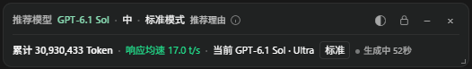
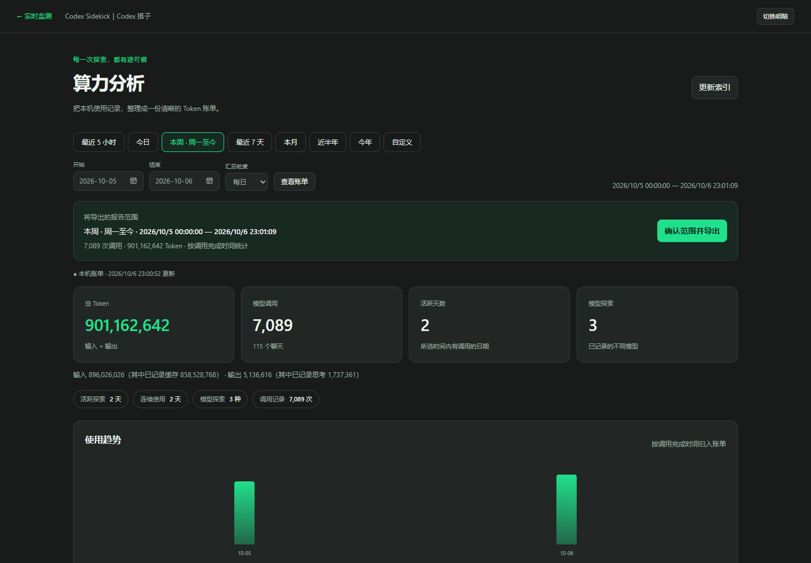
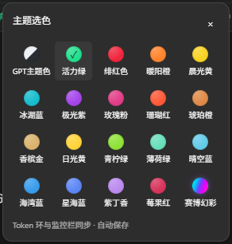
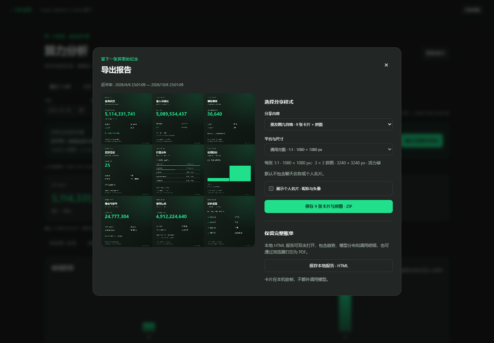

# Codex Sidekick｜Codex 搭子
### Tokens, quota & speed at a glance.

[English](README.md) · [简体中文](README.zh-CN.md)

Checking your quota interrupts your work. Token totals are scattered across chats, and choosing a model can feel like guesswork.

**Codex Sidekick puts usage, remaining quota, response speed and model suggestions beside your current Codex chat.** Open a local dashboard when you want the bigger picture.

**[Download v0.4.8 for Windows](https://github.com/KandyTiao/codex-sidekick-downloads/releases/download/v0.4.8/CodexSidekick-v0.4.8.zip)** · [Installation guide](docs/INSTALL.md) · [Release notes](https://github.com/KandyTiao/codex-sidekick-downloads/releases/tag/v0.4.8)

> **Windows tested. macOS compatibility is unverified.** A community tool, not an official OpenAI product. The current app interface and launcher filenames are in Chinese.

## See what you get

**Keep your chat open. See your usage beside it.**

| Quota in the sidebar | Monitor beside your chat |
| --- | --- |
|  |  |
| Remaining quota and reset time. Click the ring to toggle analysis. | Tokens, response speed, model and task status—plus a model suggestion. |

**Want the bigger picture? Open your local usage dashboard.**

<strong>20 themes and shareable usage cards</strong>

Choose a theme for the quota ring and monitor.

Turn a date range into nine usage cards and a collage, or save a local HTML report.

*Actual Windows captures from v0.4.x validation. The UI is in Chinese; the figures shown come from those local sessions.*

## What it solves

| The friction | Your sidekick |
| --- | --- |
| Opening menus to check limits | A quota ring with remaining percentage and reset time |
| Losing track of a chat's usage | Tokens, model, response speed and status beside the chat |
| Unsure which model to choose | Local rule-based suggestions with reasons; you stay in control |
| Chats and projects blending together | 20 themes and individual project/chat colors |
| Usage history is hard to review or share | Local reports, social cards, a nine-card grid and a collage |

### New in v0.4.8: one click in, one click out

Click the quota ring to open usage analysis. Click again to hide it. Click once more to restore the same tab and time range—without changing your current chat or creating duplicate tabs.

## Start in 3 steps

1. Install and sign in to official Codex. Have **Node.js 24+** available.
2. Download and extract the ZIP, then double-click **`安装到软件盘.cmd`** (Install). The default destination is `D:\Software\CodexSidekick`; choose another folder if needed.
3. Use the **Codex 搭子** desktop shortcut. If Codex is already running normally, finish your tasks before closing it or confirming a repair/reopen.

Windows sign-in startup and a tray watcher are enabled by default for new installs. Use **`关闭自动加载.cmd`** to disable them. Upgrades preserve your previous choice. See the [guide](docs/INSTALL.md) for custom paths, controls and troubleshooting.

## Local by design

No extra model calls for monitoring, model suggestions or share-card generation. Usage data stays on your machine; this tool does not send it to an author-operated server. Review full HTML reports before sharing: they include chat details.

**Know the limits:** response speed is the average of the latest completed call, not a live streaming counter. Local history may be incomplete and does not represent exact charges or account-wide usage. Codex updates can affect native integration.

The v0.4.8 panel interaction was tested in the Windows app. Full Windows reboot and exit/reopen recovery still need real-device validation. macOS scripts are supplied without a confirmed compatibility claim.

[How it works](DESIGN.md) · [Detailed Chinese guide](docs/USER_GUIDE.zh-CN.md) · [Changelog](CHANGELOG.md) · [Third-party credits](THIRD-PARTY-NOTICES.md)

**Free to download and use; program modification and redistribution are not permitted.** [Usage license](LICENSE). Development source is private; this repository provides product pages and downloads. Runtime scripts in the use package are covered by that license. Previously granted MIT rights and third-party licenses remain valid. Share-card signature: **Design by KandyTiao**.
